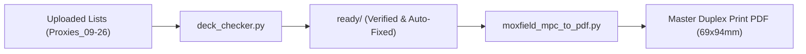

# MTG Proxy Parser to MPC-Ready PDF — User Manual & Parameter Reference

Comprehensive guide for **`moxfield_mpc_to_pdf.py`**, the automated tool that turns Moxfield/Archidekt decklists into commercial print-ready duplex PDFs with intelligent borderless bleed extension, AI super-resolution upscaling, divider cards, and double-sided card pairing.

---

## 🚀 Quick Start Recipes

### 1. Standard Production Run (Fast Scryfall Scans, 300 DPI)
Uses the verified decklists from the `ready/` directory created by `deck_checker.py`:
```bash
python3 moxfield_mpc_to_pdf.py --input-dir ready
```

### 2. Premium Production Run with AI Neural Upscaling (600 DPI)
Enhances all cards (including low-res previews and vintage scans) with **Real-ESRGAN** using Apple Silicon GPU acceleration (`mps`) or Nvidia CUDA (`cuda`):
```bash
python3 moxfield_mpc_to_pdf.py --input-dir ready --mode upscaled --upscale-factor 2 --device auto
```

### 3. Split PDFs per Person
Generates an individual print-ready PDF for each person in the order:
```bash
python3 moxfield_mpc_to_pdf.py --input-dir ready --break-by name
```

### 4. Running Directly from Google Drive
```bash
python3 moxfield_mpc_to_pdf.py --input-dir "/Users/fabian/Library/CloudStorage/GoogleDrive-haakfab@gmail.com/My Drive/Proxies_09-26/ready"
```

---

## 📖 Complete Parameter Reference

### 1. Core Mode & Quality

| Parameter | Type | Default | Description |
| :--- | :--- | :--- | :--- |
| `--mode` | `scryfall` \| `upscaled` | `scryfall` | **`scryfall`**: Downloads official high-res scans from Scryfall API and builds 300 DPI print pages (fast).<br>**`upscaled`**: Passes all card faces through the Real-ESRGAN deep-learning super-resolution model (~600+ DPI). |
| `--upscale-factor` | `2` \| `4` | `2` | Magnification factor when `--mode upscaled` is selected.<br>• `2`: Produces ~600 DPI images (optimal quality-to-filesize balance).<br>• `4`: Ultra-high resolution (larger file size). |
| `--device` | `auto` \| `mps` \| `cuda` \| `cpu` | `auto` | PyTorch compute device for Real-ESRGAN upscaling.<br>• `auto`: Detects Apple Silicon (`mps`) or Nvidia GPU (`cuda`), falling back to `cpu`.<br>• `mps`: Apple Silicon Metal Performance Shaders (M1/M2/M3/M4 Macs).<br>• `cuda`: Dedicated Nvidia GPUs on Linux/Windows or Cloud VMs.<br>• `cpu`: General CPU execution. |
| `--remove-copyright` | Flag | `False` | Detects and paints out the bottom copyright line (e.g. `™ & © Wizards of the Coast`) using card border color matching. Defaults to `False` (preserves original card text). |

---

### 2. Card Dimensions & Bleed Configuration

Standard commercial card printers (like MPC - MakePlayingCards) require exact millimeter dimensions with bleed margin to ensure no white edges appear after cutting.

| Parameter | Type | Default | Description |
| :--- | :--- | :--- | :--- |
| `--cut-width-mm` | Float | `63.0` | Target cut width of the physical card in millimeters. |
| `--cut-height-mm` | Float | `88.0` | Target cut height of the physical card in millimeters. |
| `--bleed-margin-mm`| Float | `3.0` | Bleed margin added to each side in millimeters.<br>With standard `3.0mm`, total canvas dimension is **69.0 × 94.0 mm** (`63 + 2*3` by `88 + 2*3`). |
| `--bleed-mode` | Choice | `target_mm` | Method used to compute bleed dimensions:<br>• **`target_mm`** *(Recommended)*: Exact 63×88mm cut with 3mm bleed margin (69×94mm total).<br>• **`fixed_pixels`**: Adds fixed pixel padding specified by `--bleed-pixels`.<br>• **`fixed_percentage`**: Adds percentage expansion specified by `--bleed-percentage`.<br>• **`target_inches`**: Legacy inch-based specification (2.75 × 3.75 in). |
| `--bleed-pixels` | Int | `36` | Padding in pixels per edge when using `--bleed-mode fixed_pixels`. |
| `--bleed-percentage`| Float | `5.0` | Percentage padding added when using `--bleed-mode fixed_percentage`. |
| `--reset-bleed-cache`| Flag | `False` | Forces regeneration of all cached bleed images. Essential if changing dimensions, bleed margin, or when testing bleed algorithm updates. |

#### 🖼️ Intelligent Bleed Extension 2.0 (Full-Art & Borderless Handling)
The pipeline features automated border detection:
- **Black-Bordered Cards**: Symmetrically extends pure black borders without distortion.
- **Borderless / Full-Art Cards**: Employs seamless mirror-reflection bleed extension with corner patch sampling to eliminate black corner notches or bottom baseline lines.

---

### 3. PDF Splitting & Batching

| Parameter | Type | Default | Description |
| :--- | :--- | :--- | :--- |
| `--break-by` | Choice | `none` | Controls how output PDFs are partitioned:<br>• **`none`**: Compiles all decks into a single consolidated master PDF.<br>• **`name`**: Outputs separate PDFs grouped alphabetically by person name (e.g., `Chris.pdf`, `Fabian.pdf`).<br>• **`document`**: Outputs separate PDFs for each individual decklist file.<br>• **`count`**: Splits PDFs every *N* cards (defined by `--break-count`). |
| `--break-count` | Int | `100` | Number of cards per PDF when `--break-by count` is active. |
| `--output-pdf` | String | `all_cards_individual_pages.pdf` | File name or path template for the generated PDF. |
| `--output-csv` | String | `card_totals_summary.csv` | Path for the companion CSV summarizing card counts, printings, and decks. |

---

### 4. Input Files & Cardbacks

| Parameter | Type | Default | Description |
| :--- | :--- | :--- | :--- |
| `--input-dir` | String | `input` | Directory containing decklists (`.txt`). Best practice: point to `ready/` output by `deck_checker.py`. |
| `--cardback` | String | `backs/proxy1.jpg` | Path to the default card back image used for single-faced cards. |
| `--backs-dir` | String | `backs` | Directory holding available custom cardback choices. |

---

### 5. Google Drive & Cloud Offloading

| Parameter | Type | Default | Description |
| :--- | :--- | :--- | :--- |
| `--gdrive-dir` | String | `None` | Path to your Google Drive directory, or pass `auto` to auto-detect the macOS CloudStorage GoogleDrive mount path. |
| `--offload-cache` | Flag | `False` | Copies/moves high-resolution processed image caches directly to Google Drive to conserve local SSD storage. |

---

### 6. Information & Help

| Parameter | Type | Description |
| :--- | :--- | :--- |
| `--info` | Flag | Displays this comprehensive guide with syntax highlighting in the terminal and exits. |
| `-h`, `--help` | Flag | Displays the standard CLI argument help summary. |

---

## 🖨️ Double-Sided Duplex Layout Explained

The generated PDF is built for **duplex (two-sided) printing**:
1. **Odd Pages (Fronts)**: Front face of the card (or divider card).
2. **Even Pages (Backs)**:
   - For **Single-Faced Cards**: The chosen custom card back (e.g. `backs/proxy1.jpg`).
   - For **Double-Faced Cards (Transform / MDFC)**: The corresponding back face image automatically downloaded, upscaled, and extended with matching bleed.
   - For **Divider Cards**: A custom back labeling the next person or deck.

Each page is an exact individual page matching standard commercial print specifications (no grid cutting alignment errors).

### Custom Double-Sided Cards (`&&&`)

For a proxy that glues two **unrelated** cards front-to-back (not a real Scryfall
Transform/MDFC), write one line as:

```
<qty> <Front Card Info> &&& <Back Card Info>
```

Example:
```
1 Dion, Bahamut's Dominant &&& Bahamut, Warden of Light (FIN) 16
```

- The quantity is written once, on the front side, and applies to the whole
  physical card.
- Either side may omit the set/collector number (e.g. the front here) -- the
  tool falls back to the latest/best-fit non-foil printing for that name, same
  as any normal card line.
- Each side is fetched and validated as its own independent card. Only that
  side's **front face** is used, even if the chosen printing happens to itself
  be double-faced on Scryfall.
- `deck_checker.py` validates both names against Scryfall separately; if
  either one can't be resolved, the file is flagged 🔴 RED (blocking) rather
  than silently dropping a side.

---

## 🔄 Recommended End-to-End Workflow



1. **Check and Fix Lists**:
   ```bash
   python3 deck_checker.py --dir "/path/to/Proxies_09-26"
   ```
   All valid and auto-fixed decklists are staged into `/path/to/Proxies_09-26/ready`.

2. **Generate Master Print PDF**:
   ```bash
   python3 moxfield_mpc_to_pdf.py \
     --input-dir "/path/to/Proxies_09-26/ready" \
     --mode upscaled \
     --device auto \
     --output-pdf "/path/to/Proxies_09-26/master_print.pdf"
   ```
